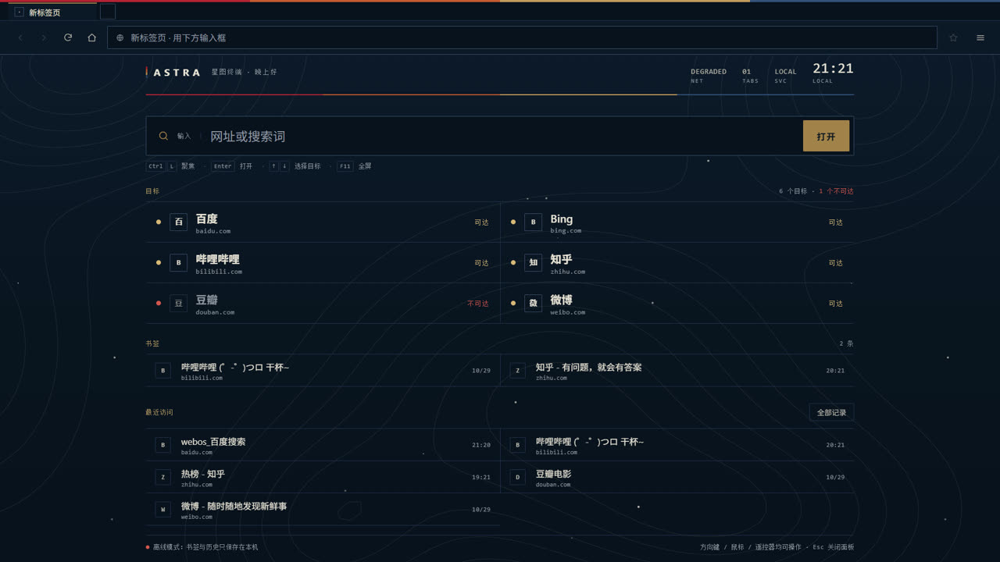
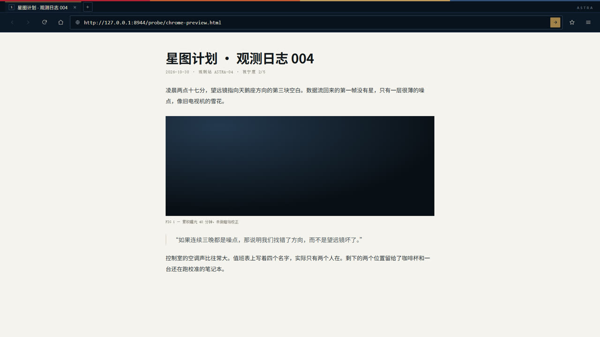
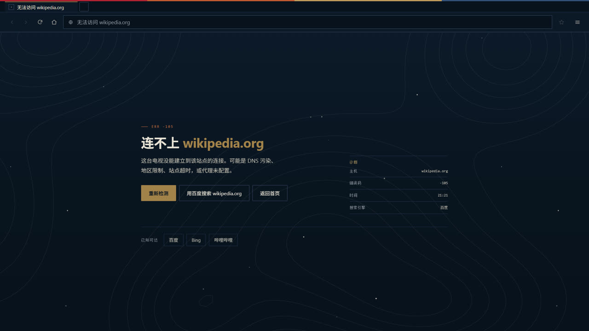

# ASTRA Browser — standalone web browser for LG webOS TV

A standalone webOS web browser for **LG OLED55G5PCA (webOS 25 / Chromium 120)**.
Does not depend on TVBox, JVM, Android WebView, or a phone bridge; does not modify the system partition, system browser, or compositor.

- App ID: `com.personal.tvwebbrowser`
- Version: `0.1.0`
- Install package: `build/com.personal.tvwebbrowser_0.1.0_all.ipk`
- Installed and launchable from the TV home screen (verified with app manager `launch`)
- Measured test report: [RESULTS.md](RESULTS.md)
- License: [MIT](LICENSE)



| Injected toolbar on external web pages | In-app error page |
| --- | --- |
|  |  |

---

## 1. Architecture

```text
webOS WebApp (WAM / Chromium 120)
  index.html (file://)  ──wake service──▶  http://127.0.0.1:7792/home
                                          │
 External web pages (Google/Baidu/...)    │  same Chromium process as WAM
   └─ webOSUserScripts/userScript.js       │
        ├─ inject browser toolbar (closed shadow)
        ├─ light DOM keyboard proxy (enter URL)
        └─ LS2 / loopback ────────────────▶  com.personal.tvwebbrowser.service
                                                 ├─ tabs / per-tab history / scroll positions
                                                 ├─ bookmarks / global history / settings
                                                 ├─ URL connectivity precheck (IPv4 TLS)
                                                 └─ static start page assets
```

Key design decisions:

1. **Web pages always load in the top-level document**, not inside an iframe.
   X-Frame-Options / CSP `frame-ancestors` do not apply to top-level navigation; therefore no site allowlist needs to be maintained, and it will not masquerade as an iframe launcher that only supports a few sites.
2. **The start page is served by a local loopback service** (`127.0.0.1:7792/home`).
   webOS prevents navigating from an external HTTPS page directly to the app's own `file://index.html`; switching to loopback HTTP lets Home / new tab / error recovery return to the browser UI from any external page, while still being a local resource and still using the same WAM Chromium.
3. **The toolbar is injected via a WAM static userScript**, automatically rebuilt after each top-level navigation; page address, title, history, and bookmarks are synced by the service.
4. **Tabs use on-demand suspension (suspended tabs)**:
   The service saves each tab's URL, title, history stack, and scroll position; only one active render document is kept at a time. Switching tabs restores the URL and history.
   This is a deliberate tradeoff for a 2 GB memory TV: no need to keep an independent renderer per tab, and no second Chromium kernel is added.
5. **Address bar keyboard input uses a light DOM proxy input**.
   An input box inside closed shadow cannot reliably get Bluetooth keyboard/IME focus in WAM; the visible address bar stays read-only, and on click focus is handed to a transparent proxy input in the page's light DOM, with keyboard input mirrored to the toolbar. The page only gets the URL text, never the service token or system APIs.
6. **The state service is the only stateful component**:
   `PalmServiceBridge` (LS2) preferred, HTTP loopback fallback; token verification; listens only on `127.0.0.1`.
7. **Failed navigation does not lose the browser UI**:
   Address bar/shortcut entry first does an IPv4 TLS connectivity precheck; DNS poisoning/blocking/timeouts show an in-app error page on the start page; WAM internal `loaderror.html` caused by external links is immediately redirected back to `/home#error=...`, where the app shows the error panel.

### Why not other approaches

- **Android WebView / JVM**: No Android ART on this device; the JVM compatibility layer is unrelated to the browser, and this task does not depend on it.
- **Plain iframe**: Many real sites forbid being embedded in an iframe, so it cannot serve as a full browser.
- **`webOSSystem.createWebView` / WebView Plus**: The API exists in WAM, but it is invalid/restricted for ordinary `trustLevel: default` apps; `netcast` apps do not inject `webOSSystem`; `com.webos.app.webviewplus` is a reserved system ID; the popup allowlist is managed by emmcd. Therefore this round does not rely on a hidden webview.
- **System Browser App**: `/mnt/otncabi/.../com.webos.app.browser/chrome` is an unregistered native Crow browser; executing it directly launches the LG system browser, but it is not a customizable standalone UI. This app does not invoke it, does not override it, and does not treat "launching the system browser" as a self-developed browser.
- **Starting a separate Chromium process**: Would duplicate GPU/network/browser overhead; this app reuses WAM's Chromium 120.

---

## 2. Features

- Address bar: URL or search term; search engine switchable (Google/Bing/DuckDuckGo/Baidu)
- Web pages: modern JavaScript, CSS, scrolling, link navigation, login cookies (shared WAM profile)
- Top-level navigation, no iframe site allowlist
- Forward, back, refresh, home
- Multiple tabs: new, switch, close; per-tab history and scroll position restoration (on-demand suspension)
- Bookmarks, history, last-session restoration
- Page zoom (0.75x–1.5x), fullscreen/hide toolbar
- Mouse-first UI, remote-compatible; desktop-browser-style 1920×1080 UI
- Error page / network unreachable prompt, without losing the browser toolbar
- Connectivity precheck: IPv4 TLS + certificate hostname verification, to avoid DNS-poisoned sites hanging Chromium

### Keyboard shortcuts

| Shortcut | Function |
| --- | --- |
| Ctrl+L | Focus address bar |
| Ctrl+T | New tab (local start page) |
| Ctrl+W | Close current tab |
| Ctrl+Tab / Ctrl+Shift+Tab | Next / previous tab |
| F5 / Ctrl+R | Refresh |
| Alt+← / Alt+→ | Back / forward |
| Ctrl+D | Add/remove bookmark |
| Ctrl+H | History |
| F11 | Fullscreen / hide toolbar |
| Ctrl++ / Ctrl+- / Ctrl+0 | Zoom in / zoom out / reset |

All Chinese labels and buttons are clickable; the menu also provides bookmarks, history, settings, and fullscreen entries.

---

## 3. Build & install

No npm dependencies (only uses the TV's built-in Node 16 and webOS services).

```bash
# 1. Sync start-page -> service/public + package with official ares-package (if present)
#    Falls back to built-in packer with location info if ares-package is missing.
node tools/build.mjs
# Output: build/com.personal.tvwebbrowser_0.1.0_all.ipk
# Verify: ares-package -i build/com.personal.tvwebbrowser_0.1.0_all.ipk  (or tools/verify-ipk.mjs)

# Simulator (webOS TV Simulator 1.4/1.5: www.webosose.org/tools/simulator)
#   Install SDK: brew install node@20 webos-cli || npm i -g @webos-tools/cli
#   Then: bash tools/sim-launch.sh   (builds + ares-install + ares-launch to your Simulator device)
#   Inspect: ares-inspect --device <sim> com.personal.tvwebbrowser

# 2. Upload and install (run on PC; TV_HOST/SSH key per your environment)
scp -i ~/.ssh/id_ed25519_lgtv_g5 \
  build/com.personal.tvwebbrowser_0.1.0_all.ipk \
  root@192.168.31.60:/tmp/astra-browser.ipk

ssh -i ~/.ssh/id_ed25519_lgtv_g5 root@192.168.31.60 \
  "luna-send -i luna://com.webos.appInstallService/dev/install \
  '{\"id\":\"com.personal.tvwebbrowser\",\"ipkUrl\":\"/tmp/astra-browser.ipk\",\"subscribe\":true}'"

# 3. Launch
ssh -i ~/.ssh/id_ed25519_lgtv_g5 root@192.168.31.60 \
  "luna-send -n 1 luna://com.webos.applicationManager/launch \
  '{\"id\":\"com.personal.tvwebbrowser\"}' < /dev/null"
```

First-launch flow: `file://index.html` → wake `com.personal.tvwebbrowser.service` → jump to `http://127.0.0.1:7792/home`. If the service is unavailable, the file start page still works as a fallback UI.

### Test scripts (PC side)

```bash
node probe/acceptance.mjs   # blocked-site, Baidu, tabs, bookmarks
node probe/interaction.mjs  # mouse, wheel, keyboard, F11, zoom, tabs, restore
node tools/tvcheck.mjs      # On-device: CDP to get DOM facts + screenshots
node tools/tvwheel.mjs      # On-device: inject wheel events, verify scroll delta
node tools/scrolltest.mjs   # Local: arrow keys/wheel still scroll after toolbar click (regression)
node tools/keycheck.mjs     # Local: spatial arrow-key navigation and panel focus
```

Scripts default to TV `192.168.31.60`, SSH key `~/.ssh/id_ed25519_lgtv_g5`, and set up CDP `9998→20998` and HTTP `7792→17792` tunnels.

---

## 4. File layout

```text
app/
  appinfo.json          # App registration, icon, keyboard/mouse settings
  index.html/app.css/app.js/config.js
  webOSUserScripts/userScript.js   # Toolbar injected into external pages
  icon.png / largeIcon.png
service/
  service.js            # LS2 + loopback state service, static /home
  package.json/services.json
  public/               # Start page assets synced by tools/build.mjs
tools/
  build.mjs             # Sync public + package IPK
  pack-ipk.mjs          # Standalone webOS IPK packager (includes service)
  gen-backdrop.mjs      # Generate contour topographic background (marching squares)
  tvcheck/tvwheel/scrolltest/keycheck/shots.mjs   # On-device and local verification
probe/
  acceptance.mjs        # Functional acceptance
  interaction.mjs       # Interaction acceptance
docs/                   # README screenshots
results/                # Screenshots, JSON measured results (not committed)
README.md / RESULTS.md / LICENSE
```

Service data: tries `/var/palm/data/com.personal.tvwebbrowser.service` first, falls back to `/tmp/tv-browser/state.json` in the current install environment; the start page keeps a backup copy in `localStorage`, used for cross-restart recovery when service state is empty.

---

## 5. Security boundaries

- The service only listens on `127.0.0.1:7792` and is not exposed to the LAN.
- State APIs require a 32-byte token; the token only exists in closures of the app/injected script and is never written into URLs. The token in the repo is a **fixed local protection value, not an external credential** — it only blocks other local web pages from accidentally calling loopback, and has no corresponding remote account; replace it as needed when deploying to your own TV (the three places `app/config.js`, `app/webOSUserScripts/userScript.js`, `service/service.js` must be consistent).
- External web pages can only attempt to call the service via the WAM-provided `PalmServiceBridge`; without the token they cannot read/write state; the service provides no shell, file, Root, or generic Node interface.
- The injected toolbar uses a closed shadow root; pages cannot directly read the toolbar DOM/service token. Pages can still remove the host node; MutationObserver will try to remount it.
- Does not modify `/usr`, the system browser, compositor, TVBox, JVM, or system resolution.

## 6. Known limitations

- **Tabs use a suspension model**, not multi-renderer live tabs; switching tabs reloads the target URL but preserves per-tab history/scroll. This is deliberate under 2 GB memory. Truly parallel tabs would need an available trusted sub-webview / WebView Plus or multi-window capability, verified unavailable in this round.
- **Google / Wikipedia / GitHub are unreachable on the current TV network**: DNS is poisoned and TCP/SNI times out. The app shows a clear error page; configure a VPN or proxy on the TV/router to access them. Baidu, Bing, and example.com have been verified working.
- **Mouse wheel**: WAM does not turn wheel input into page scrolling (measured: events reach the page, but native scrolling does not happen). The injected script takes over wheel events in the capture phase, finds the innermost scrollable ancestor itself and scrolls, then `preventDefault`; measured on TV, a delta of 400 scrolls 400px, without duplication. Wheel events on the toolbar and tab bar each have their own handling.
- **Physical Bluetooth keyboard/mouse**: Input logic was verified with CDP mouse/keyboard events and the light DOM keyboard proxy; no physical key presses were made by the proxy. Please do one manual confirmation on the TV (see the manual acceptance checklist in RESULTS).
- Page zoom is implemented via `body.style.zoom`; a few sites with forced fixed layouts may display abnormally.
- Download management, find-in-page, password management, and extensions are not yet implemented.
- Some strict CSP sites may block loopback HTTP; state sync prefers LS2, and core navigation is unaffected.

## 7. Manual acceptance checklist

1. Click the **ASTRA Browser** icon on the TV home screen and confirm the start page appears.
2. Click the Baidu shortcut entry with a Bluetooth mouse; after the page loads, confirm the top toolbar is still visible.
3. Click the address bar and type `https://www.baidu.com/s?wd=webos` with a Bluetooth keyboard, then press Enter.
4. Scroll the results page with the wheel; click toolbar back/forward, refresh, home.
5. Ctrl+T for a new tab, switch, Ctrl+W to close; confirm the tab bar changes.
6. Ctrl+D to bookmark the current page, check menu → Bookmarks; menu → History.
7. F11 to hide/show the toolbar; verify zoom with Ctrl++/Ctrl+-/Ctrl+0.
8. Close the browser and confirm other TV apps (TVBox/live streaming) are unaffected.
9. If you need Google/Wikipedia/GitHub: first enable a working VPN/proxy on the TV/router, then retry in the address bar.

---

## 8. License

[MIT](LICENSE) © 2026 Yukikaze1945

The UI color scheme references the red / rust orange / gold / navy four-color palette and contour visual language used by Bethesda's official *Starfield* site; all code and implementation were completed independently by this project, are unrelated to Bethesda, and use none of its assets.
